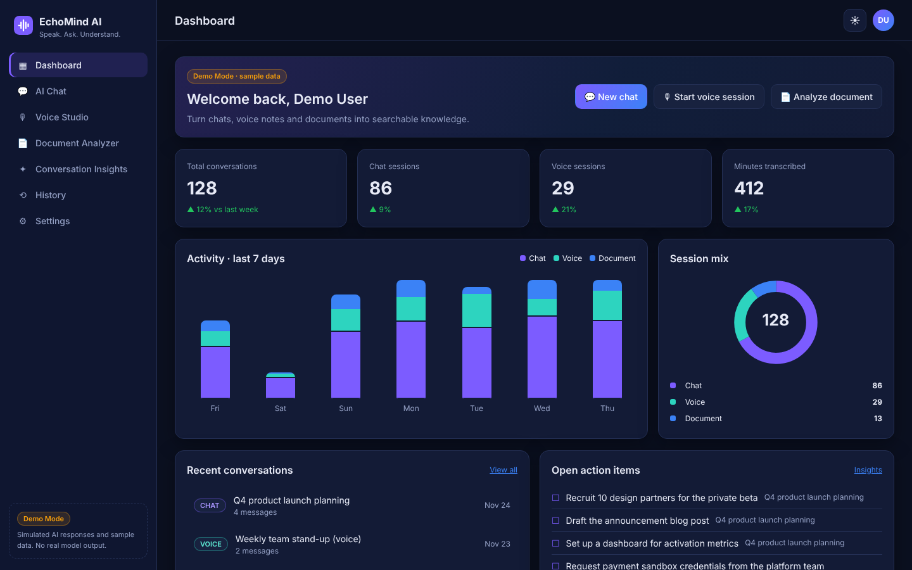
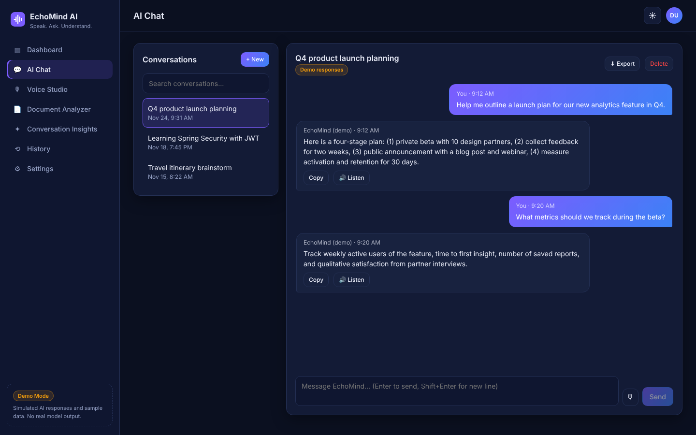
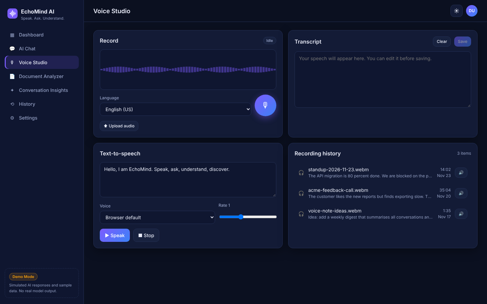
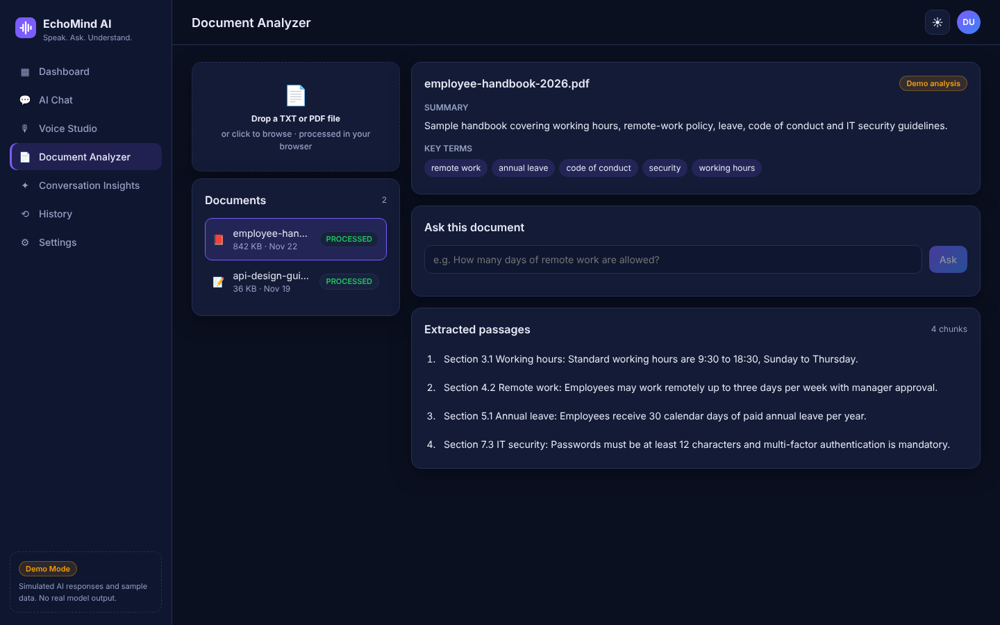
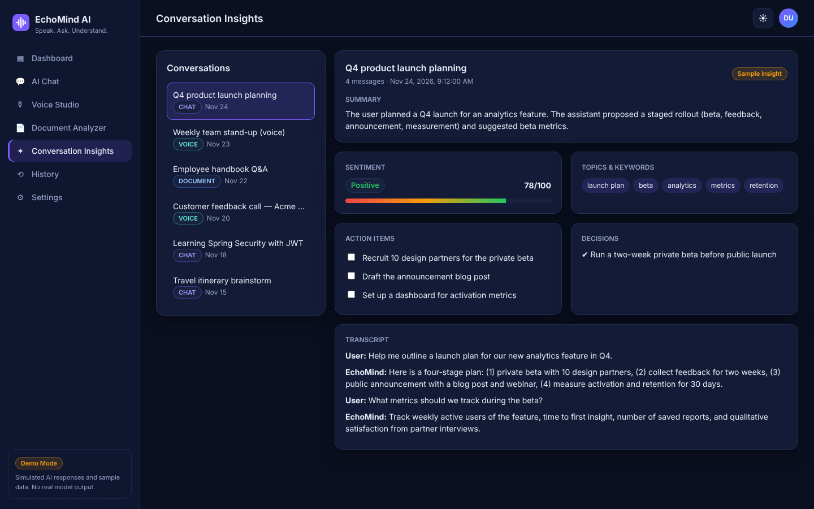
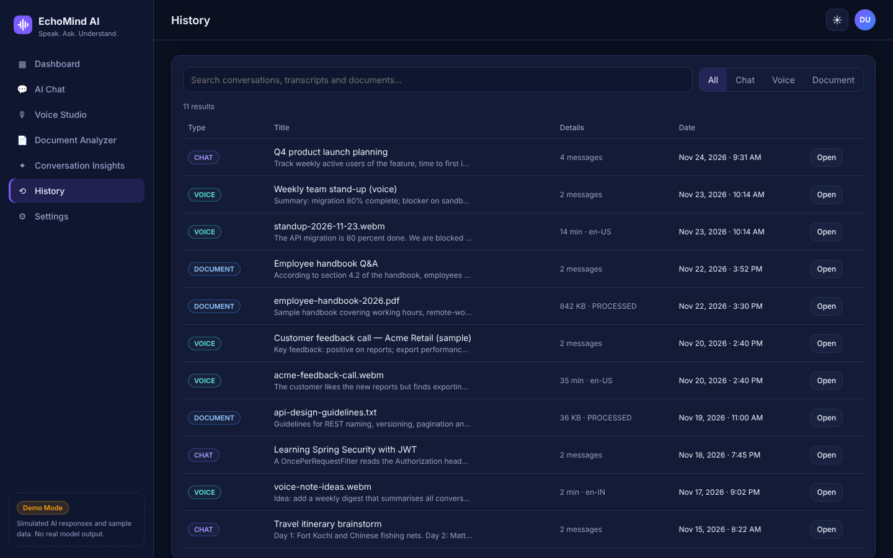
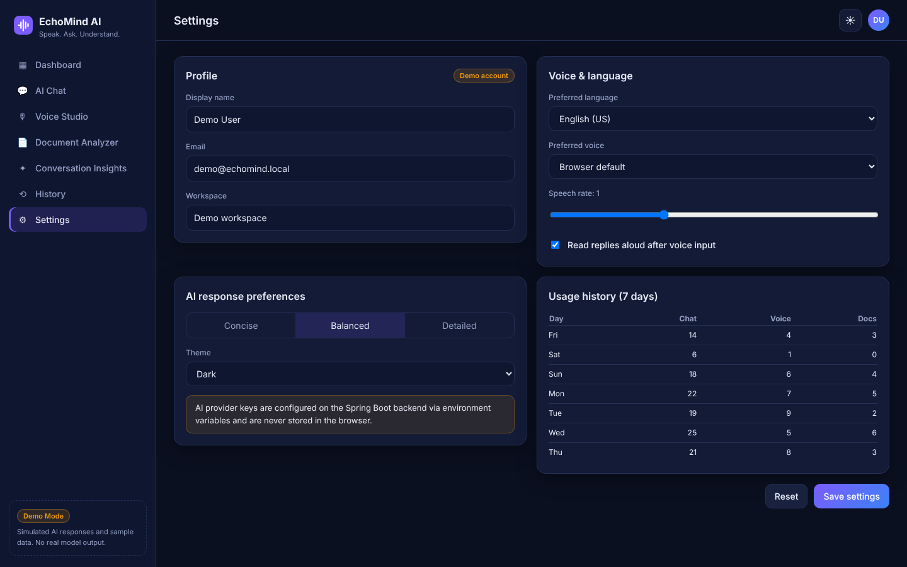

# EchoMind AI — Voice & Knowledge Intelligence Platform

> **Speak. Ask. Understand. Discover.**

EchoMind AI is a full-stack Generative AI and Voice Intelligence platform built with **Angular**, **Java Spring Boot** and **MySQL**. It combines AI chat, voice interaction, speech transcription, document analysis, conversation insights and usage analytics in one responsive application.

**🔗 Live demo (frontend, Demo Mode):** https://sureshnarayananankumar.github.io/echomind-ai/

> ⚠️ **Demo Mode** — the hosted site runs entirely in the browser with sample data and simulated AI responses. Nothing shown there is real model output. Connect the Spring Boot backend and an AI provider for real responses.



## Features

| Module | What it does |
| --- | --- |
| **Dashboard** | Session totals, 7-day activity chart, session mix, recent conversations, open action items |
| **AI Chat** | Create/search/delete conversations, send prompts, copy & listen to replies, export to Markdown, dictate by voice |
| **Voice Studio** | Mic recording with live waveform, speech-to-text (Web Speech API), editable transcripts, text-to-speech with voice/rate selection, audio upload, recording history |
| **Document Analyzer** | Drag-and-drop TXT/PDF, extracted passages, summary, key terms, ask-the-document Q&A with source highlighting |
| **Conversation Insights** | Summary, sentiment meter, keywords, action items checklist, decisions, transcript |
| **History & Search** | Unified search across chats, recordings and documents with type filters |
| **Settings** | Profile, language, voice, speech rate, response style, light/dark theme, usage history |

## Tech stack

| Layer | Technology |
| --- | --- |
| Frontend | Angular 19 (standalone components, signals, lazy routes), TypeScript, CSS |
| Backend | Java 21, Spring Boot 3.3, Spring Security + JWT, Spring Data JPA |
| Database | MySQL 8 |
| AI | Provider abstraction — `DEMO` (offline) or any OpenAI-compatible API |
| Voice | Browser Web Speech API (prototype); pluggable server STT/TTS |
| Docs | Springdoc OpenAPI / Swagger UI |
| CI/CD | GitHub Actions → GitHub Pages (frontend), Maven verify (backend) |

## Repository structure

```text
echomind-ai/
├── frontend/echomind-angular/     Angular app (deployed to GitHub Pages)
│   └── src/app/
│       ├── core/                  demo data, demo AI, speech & settings services
│       ├── dashboard/  ai-chat/  voice-studio/  document-analyzer/
│       └── conversation-insights/  history/  settings/
├── backend/echomind-api/          Spring Boot REST API
│   └── src/main/java/com/echomind/
│       ├── config/  controller/  service/  repository/
│       └── entity/  dto/  security/  ai/
├── database/
│   ├── echomind_schema.sql
│   └── echomind_seed_data.sql
├── docs/
│   ├── architecture.md
│   ├── api-documentation.md
│   └── screenshots/
└── .github/workflows/             Pages deploy + backend CI
```

## Getting started

### 1. Frontend (Demo Mode)

```bash
cd frontend/echomind-angular
npm install
npm start            # http://localhost:4200
```

Voice features need Chrome or Edge and microphone permission.

### 2. Database

```bash
mysql -u root -p < database/echomind_schema.sql
mysql -u root -p echomind_ai < database/echomind_seed_data.sql
```

Development-only demo login: `demo@echomind.local` / `Demo@12345`.

### 3. Backend

```bash
cd backend/echomind-api
export DB_URL="jdbc:mysql://localhost:3306/echomind_ai"
export DB_USERNAME=root DB_PASSWORD=yourpassword
export JWT_SECRET="$(openssl rand -base64 48)"
# Optional real AI:
# export AI_PROVIDER=OPENAI AI_API_KEY=sk-... AI_MODEL=gpt-4o-mini
mvn spring-boot:run   # http://localhost:8080/swagger-ui.html
```

| Variable | Default | Purpose |
| --- | --- | --- |
| `DB_URL` / `DB_USERNAME` / `DB_PASSWORD` | local MySQL | Database connection |
| `JWT_SECRET` | dev-only value | HMAC signing key (≥ 32 bytes) |
| `AI_PROVIDER` | `DEMO` | `DEMO` or `OPENAI` |
| `AI_BASE_URL` / `AI_API_KEY` / `AI_MODEL` | OpenAI defaults | OpenAI-compatible endpoint |
| `CORS_ALLOWED_ORIGINS` | localhost + `*.github.io` | Allowed frontend origins |

AI keys live only on the backend — the Angular app never calls an AI provider directly.

## API overview

| Method | Endpoint | Purpose |
| --- | --- | --- |
| POST | `/api/auth/register` | Register |
| POST | `/api/auth/login` | Login (returns JWT) |
| GET | `/api/dashboard/summary` | Dashboard metrics |
| GET | `/api/conversations` | List / search conversations |
| POST | `/api/conversations` | Create conversation |
| GET | `/api/conversations/{id}/messages` | Get messages |
| POST | `/api/conversations/{id}/messages` | Send a message (+ AI reply) |
| POST | `/api/ai/chat` | Stateless AI response |
| POST | `/api/voice/transcribe` | Store audio + transcript |
| POST | `/api/voice/speech` | Server TTS (placeholder) |
| POST | `/api/documents` | Upload a document |
| POST | `/api/documents/{id}/ask` | Ask about a document (basic RAG) |
| GET | `/api/insights/{conversationId}` | Conversation insights |
| GET | `/api/usage` | Usage history |

See [docs/api-documentation.md](docs/api-documentation.md) and [docs/architecture.md](docs/architecture.md).

## Screenshots

| Chat | Voice Studio |
| --- | --- |
|  |  |
| **Document Analyzer** | **Conversation Insights** |
|  |  |
| **History** | **Settings** |
|  |  |

## Roadmap

- [x] Phase 1 — Angular UI prototype with demo data
- [x] Phase 2 — Spring Boot API, JWT, MySQL schema & seed, Swagger
- [ ] Phase 3 — Connect Angular to the API, server STT/TTS provider, embeddings-based RAG
- [ ] Phase 4 — More tests, error/empty states, demo video
- [ ] Phase 5 — Host backend (Render/Railway) + managed MySQL

Future ideas: streaming voice conversations, multilingual speech, meeting speaker separation, approved multi-step AI agents, team workspaces.

## License

[MIT](LICENSE)
